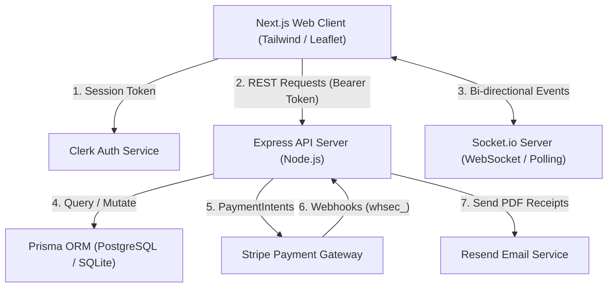
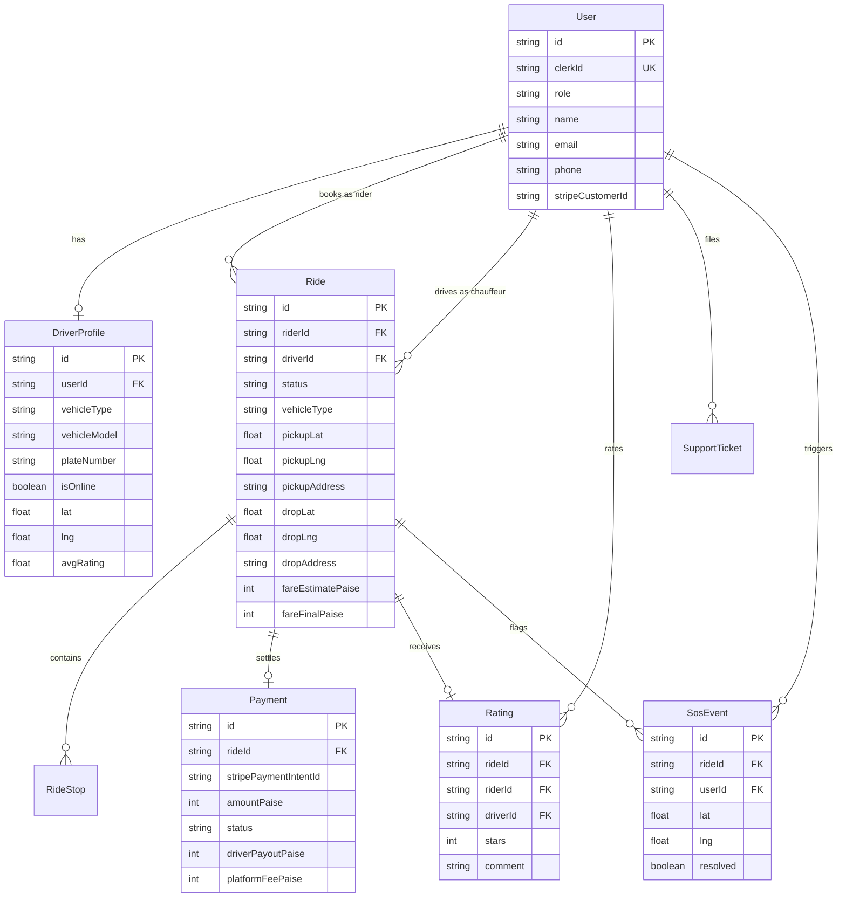

# Veloce — Private Mobility & Chauffeur Platform

Veloce is a full-stack, enterprise-grade ride-hailing and private mobility platform built with Next.js 15, Node.js/Express, Socket.io, Prisma ORM, Clerk Authentication, and Stripe Payments.

> 🎙️ **Project Presentation & Demo Speech:** For an end-to-end presentation and video walkthrough script tailored to this project, see [docs/PRESENTATION_SPEECH.md](docs/PRESENTATION_SPEECH.md).

---

## 1. Feature Map (13 Core Use Cases)

| # | Use Case | Implementation Details |
|---|---|---|
| **1** | **Rider & Driver Authentication** | Verified Clerk session token on every API call and WebSocket handshake; role derived server-side (`RIDER`, `DRIVER`, `ADMIN`). |
| **2** | **Vehicle & Chauffeur Profiling** | Chauffeur onboarding, vehicle model selection, license plate validation, and status indexing. |
| **3** | **Interactive Routing & Geocoding** | Real-time map geocoding search and reverse geocoding with 60 req/min rate limiting. |
| **4** | **Multi-Stop Itineraries** | Dynamic intermediate stop waypoints with auto-recalculated routing and distance meters. |
| **5** | **Fare Estimation & Promotional Discounts** | Distance/duration fare calculation, vehicle class multipliers, and promo codes (`SAVE10`, `FIRST50`, `WELCOME20`). |
| **6** | **Real-Time Dispatch Engine** | Targeted Socket.io dispatch broadcasts to online vehicle rooms (`drivers:Veloce X`) with atomic claim locking. |
| **7** | **Interactive Journey Lifecycle** | Real-time state machine: `REQUESTED` &rarr; `ACCEPTED` &rarr; `ARRIVED` &rarr; `IN_PROGRESS` &rarr; `COMPLETED`. |
| **8** | **Emergency SOS Beacon** | In-ride SOS activation persisting `SosEvent` in DB, broadcasting live alerts to admin rooms, and generating HMAC-SHA256 tracking links. |
| **9** | **Live Journey Tracking Link** | Public, 12-hour signed session link for emergency contacts with live GPS polling and tamper protection. |
| **10** | **Card Payments & Webhook Processing** | Saved card checkout flow; payment records transition to `SUCCEEDED` only via verified Stripe webhooks. |
| **11** | **Automated PDF Invoices & Resend Delivery** | Vector PDF receipt generation using PDFKit; asynchronous delivery to rider inbox via Resend. |
| **12** | **Driver Earnings Ledger** | Transparent 80/20 driver revenue ledger and trip settlement audit log. |
| **13** | **Administrative Oversight** | Live metrics dashboard, fleet statistics, and instant SOS emergency banner alerts. |

---

## 2. Architecture Diagram



---

## 3. Entity Relationship (ER) Diagram



## 4. Repository Structure & Folder Segregation

The project is structured as a clean, modular pnpm monorepo segregating frontend, backend, shared contracts, and deployment specifications:

```
veloce/
├── frontend/                # 🌐 FRONTEND (Next.js 16, React 19, Tailwind CSS, Leaflet)
│   ├── src/app/             # App router pages (dashboard, driver, admin, track, etc.)
│   ├── src/components/      # Reusable UI components (MapComponent, Stepper, etc.)
│   └── src/lib/             # Frontend API client and utilities
│
├── backend/                 # ⚙️ BACKEND (Node.js, Express, Socket.io, Prisma, Stripe)
│   ├── prisma/              # Prisma schema, SQLite & PostgreSQL configs, migrations
│   ├── src/routes/          # REST route handlers (rides, driver, admin, geocode, etc.)
│   ├── src/services/        # Business logic (fare, routing, stripe, receipt, tracking)
│   ├── src/middleware/      # Auth (Clerk), RBAC, rate limiting middleware
│   └── tests/               # Backend integration test suite
│
├── packages/
│   └── shared/              # 📦 SHARED TYPES & SCHEMAS (Zod validation contracts)
│
├── apps/                    # 🔗 LEGACY ALIAS JUNCTIONS (apps/web -> frontend, apps/api -> backend)
├── docs/                    # 📚 DOCUMENTATION (API reference specs)
├── .github/workflows/       # 🤖 CI / CD (GitHub Actions quality gate)
├── DEPLOY.md                # 🚀 PRODUCTION DEPLOYMENT GUIDE (Step-by-step)
└── render.yaml              # ☁️ RENDER DEPLOYMENT BLUEPRINT
```

---

## 5. Local Setup & Quickstart

### Prerequisites
- Node.js `>= 20.0.0`
- pnpm `>= 9.0.0`

### Installation
```bash
# Clone and install dependencies
git clone <repository_url>
cd veloce
pnpm install

# Generate Prisma Client & push database schema
pnpm build:backend
pnpm --filter api exec prisma db push
```

### Running Frontend and Backend (Segregated Scripts)

You can run both concurrently or start each application individually:

```bash
# Start both Frontend and Backend concurrently
pnpm dev

# Or start Backend independently (Port 4000)
pnpm dev:backend

# Or start Frontend independently (Port 3000)
pnpm dev:frontend
```

---

## 5. Environment Variables Reference

| Variable Name | Required | Target | Description |
|---|---|---|---|
| `DATABASE_URL` | Yes | API | PostgreSQL or SQLite database connection URI |
| `DIRECT_URL` | Optional | API | Direct PostgreSQL URI for connection pooling |
| `CLERK_SECRET_KEY` | Yes | API & Web | Clerk private backend secret key |
| `CLERK_PUBLISHABLE_KEY` | Yes | Web | Clerk public client publishable key |
| `CORS_ORIGIN` | Optional | API | Allowed frontend origin for CORS policies |
| `STRIPE_SECRET_KEY` | Required for Live Payments | API | Stripe secret key (`sk_test_...` or `sk_live_...`) |
| `STRIPE_WEBHOOK_SECRET` | Required for Live Payments | API | Stripe webhook signing secret (`whsec_...`) |
| `RESEND_API_KEY` | Optional | API | Resend API key for emailing receipts |
| `RESEND_FROM` | Optional | API | Sender email address for PDF receipts |
| `TRACKING_SECRET` | Optional | API | Secret key for signing emergency tracking tokens |

---

## 6. Testing & Quality Commands

```bash
# Run comprehensive API integration tests (9 test suites)
pnpm --filter api test

# Run TypeScript typechecks across all workspaces
pnpm --filter shared exec tsc --noEmit
pnpm --filter api exec tsc --noEmit
pnpm --filter web exec tsc --noEmit
```
